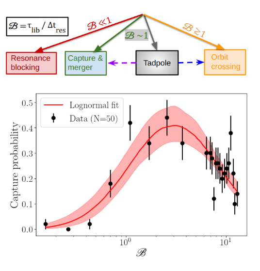
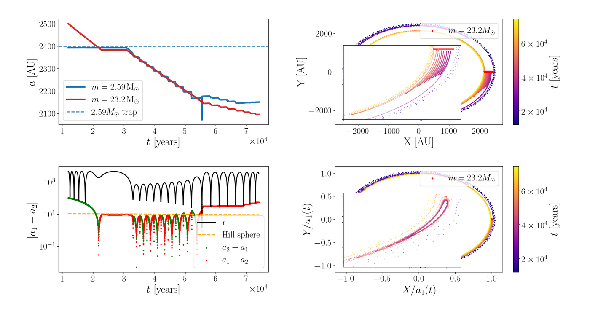
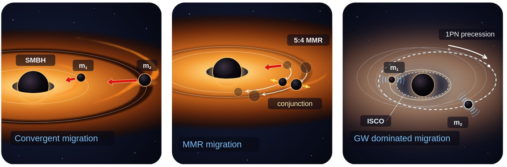
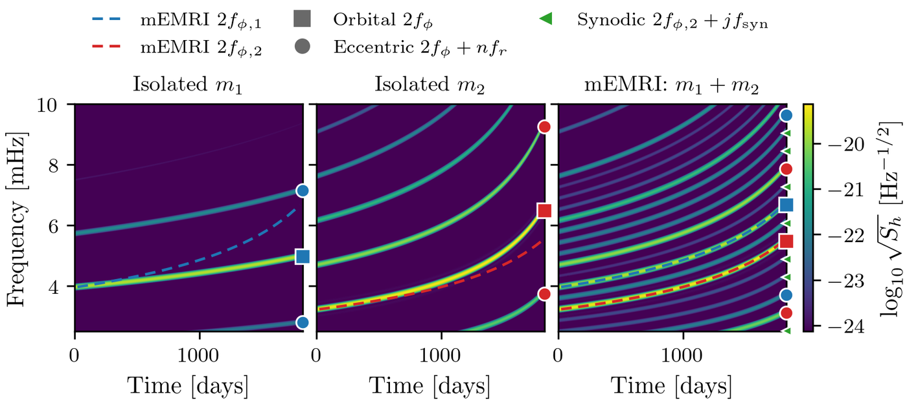
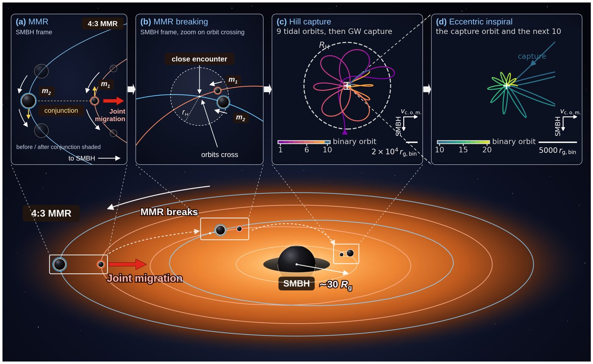
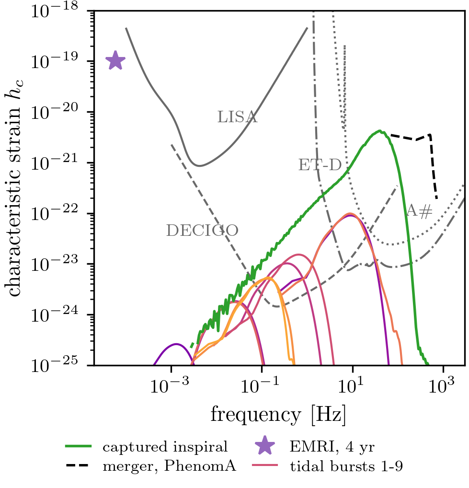
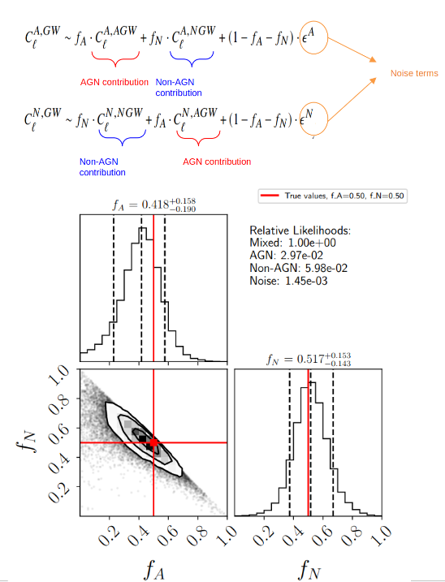

<!-- Small page-only styles for figure layout (safe to move into _sass later). -->

Gravitational wave detectors have now recorded hundreds of binary black hole mergers, and some of them are hard to explain with standard channels such as isolated binary evolution or dynamical capture in a dense cluster. Examples include mergers with very unequal masses, black holes in the pair-instability gap, or detections with signs of residual eccentricity. The gaseous discs of active galactic nuclei (AGN) are a leading alternative to explaining such events. In this proposed scenario black holes captured into the disc migrate like planets, encounter one another, and merge rapidly.

My PhD research has focused on the gravitational dynamics of black hole encounters in AGN discs, including the formation of mean motion resonance chains, extreme mass ratio inspirals, and binary black hole mergers.

## Black hole encounters in AGN discs

<figure class="research-fig">
  
  <figcaption>The outcome of an encounter is set by 𝓑, the ratio of the resonant libration time to the time to cross the resonance. Capture and merger peak at 𝓑 ≈ 1–3; smaller values block the encounter in resonance, larger ones lead to orbit crossing.</figcaption>
</figure>

I used the regularised few-body code TSUNAMI (post-Newtonian terms to 3.5PN) coupled with self-consistent AGN disc models and migration torques, and simulated black-hole encounters across a wide range of disc and mass parameters. We found that encounters often do *not* end in mergers: convergent migration traps the pair in resonance. Borrowing on results in resonance capture theory from planetary dynamics, I derived an analytic criterion for the capture probability as a function of AGN disc parameters and black hole masses that matched the simulations very well. Applying this model to the highly unequal mass event GW190814, it shows that such mergers are favoured only in a narrow range of the AGN parameter space.

<figure class="research-fig">
  
  <figcaption>A simulated pair of black holes (2.6 and 23 M☉) caught in a co-orbital resonance near a migration trap: semi-major axes and separation over time (left), and the orbit in the inertial and co-rotating frames (right).</figcaption>
</figure>

*Moncrieff, Grishin, Trani, Panther & Pietrosanti 2026, MNRAS 545, staf2217* · [paper](https://doi.org/10.1093/mnras/staf2217) · [arXiv](https://arxiv.org/abs/2511.09129)

## Lasting mEMRIs: resonant pairs in the LISA band

<figure class="research-fig">
  
</figure>

Black holes that stay locked in resonance can migrate together all the way to the central supermassive black hole. For SMBH masses below about 106 M☉, the resonance survives once gravitational wave emission dominates gaseous migration torques for low enough mass ratios, so an AGN can host **multiple Extreme Mass Ratio Inspirals (mEMRIs)**, observable simultaneously by LISA. We show that such mEMRIs have an interesting gravitational wave phenomenology that encodes information about the mean motion resonance, which if not accounted for could bias EMRI parameter estimation.

<figure class="research-fig">
  
  <figcaption>Simulated spectrograms of two isolated EMRIs (left, centre) and the same black holes in a mean motion resonance mEMRI (right). The resonant pair adds synodic sidebands and shifted harmonics, so analysing it as an isolated EMRI would give incorrect estimates of the masses.</figcaption>
</figure>

*Moncrieff, Grishin, Panther & Trani 2026, submitted to MNRAS* · [arXiv:2610.29376](https://arxiv.org/abs/2610.29376)

## Relativistic resonance breaking: eccentric mergers near the supermassive black hole

<figure class="research-fig">
  
  <figcaption>(a) A resonant pair migrates inward; (b) relativistic precession breaks the resonance and the orbits cross; (c) repeated encounters inside the Hill sphere, perturbed by the SMBH's tide, end in gravitational-wave capture; (d) a highly eccentric inspiral.</figcaption>
</figure>

Around more massive black holes, compact mean motion resonances become unstable due to mean motion resonance overlap about 10–30 gravitational radii from the SMBH. After mean motion resonance breaking, black holes then undergo repeated close encounters that almost always end in a near head-on collision or a highly eccentric merger, deep inside the SMBH's potential. There, line-of-sight acceleration, Doppler shifts, and strong lensing should leave measurable imprints on the gravitational waves. The detection of such environmental effects would provide smoking gun signatures of the AGN channel. This paper is in preperation, arxiv link coming soon.

<figure class="research-fig">
  
  <figcaption>Gravitational-wave spectrum of one capture: repeated tidal bursts before capture, then an eccentric inspiral and merger, compared with LISA, DECIGO, Einstein Telescope and LIGO A# sensitivities.</figcaption>
</figure>

*Moncrieff, Grishin, Panther & Trani, in preparation*

## What fraction of BBH mergers come from AGN? A statistical test

<figure class="research-fig">
  
  <figcaption>A mixture model of the angular cross-correlation between gravitational-wave skymaps and AGN and galaxy catalogues recovers the AGN fraction fA of a simulated population.</figcaption>
</figure>

Individual mergers are too poorly localised to identify their host galaxies. AGN cluster more strongly than ordinary galaxies, so cross-correlating gravitational wave skymaps with AGN and galaxy catalogues can measure what fraction of mergers happen in AGN. I developed a new statistical technique to determine the fraction of BBH mergers coming from AGN using angular cross correlation. We found that after roughly 5,000–10,000 detected mergers at A# sensitivity, this can accurately determine the fraction of BBH mergers coming from AGN.

*Moncrieff & Panther 2025, MNRAS 543, 1833* · [paper](https://doi.org/10.1093/mnras/staf1582)

## What's next

I am building these results into a general theory of resonances with relativistic precession, gravitational-wave dissipation and turbulent forcing, which applies to planets as well as black holes. I am also developing waveform-level models of environmental effects, and population predictions that can be tested against gravitational-wave catalogues.
